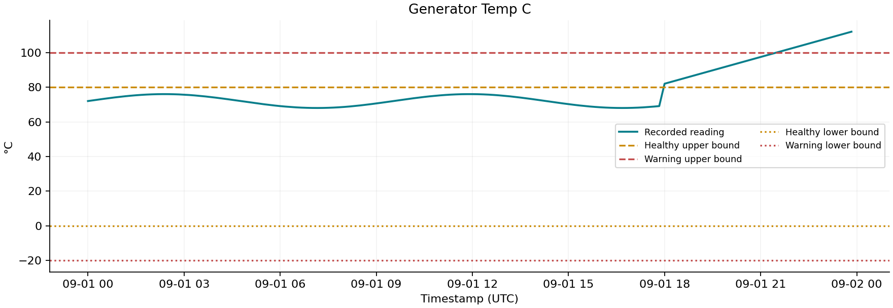
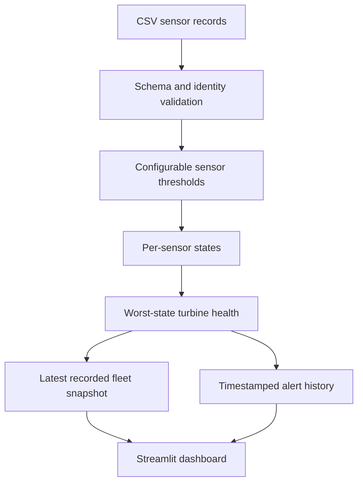

# TurbineHealth Monitor

**Wind Turbine Operational Health Monitoring System**

A transparent Streamlit dashboard for recorded turbine sensor health. Choose a
turbine, inspect nine readings and their HEALTHY / WARNING / CRITICAL states, explore
trends and review timestamped alerts. Every alert explains the threshold involved.

This is **health monitoring only**: no ML, failure forecasting, remaining useful life
or predictive maintenance. The sample is historical synthetic data and all thresholds
are configurable demonstration choices. They are not Siemens Gamesa specifications.
Independent portfolio project, with no company affiliation or endorsement.

## What to try

- The fixture has 432 readings from three turbines on 1 September 2026.
- `WT-001` ends HEALTHY, `WT-002` ends WARNING (gearbox temperature), and `WT-003`
  ends CRITICAL (generator temperature and vibration).
- Select each turbine and inspect sensors, history and recent alerts.
- Adjust the generator temperature thresholds to observe classification changes.
- Upload a same-schema CSV; malformed identities reject the input, while missing
  sensor values explicitly produce a CRITICAL data-quality alert.



## Architecture



## Classification rules

Healthy ranges are inclusive. Values outside healthy but inside the warning
envelope are WARNING. Values outside that envelope, missing readings or implausible
values are CRITICAL. The worst sensor state wins. A CRITICAL data-quality alert does
not by itself establish an equipment fault.

See [data/SCHEMA.md](data/SCHEMA.md) for all fields and threshold ranges. Thresholds
live in immutable `Threshold` objects; `HealthMonitor` accepts a complete custom mapping.
The UI exposes generator temperature limits. Invalid threshold nesting is rejected.

## Run locally

Python 3.11 or 3.12 is recommended. From this repository's root:

```bash
python -m venv .venv
```

Activate with `.venv\Scripts\Activate.ps1` in Windows PowerShell, or
`source .venv/bin/activate` on macOS/Linux, then:

```bash
python -m pip install -r requirements-dev.txt
python -m pytest
```

Runtime dependencies are specified in `pyproject.toml`. `requirements.txt`
installs the local package; `requirements-dev.txt` also installs test/build tools.
No secrets or paid services are required for local use.

```bash
python -m streamlit run streamlit_app.py
python scripts/generate_sample.py
```

Uploads stay in session memory and are not stored in a database. The sample loads
without external network services or an account. The timestamp shown is the latest
**recorded** sample; this dashboard does not claim to show current or live equipment health.

## Tests and CI

Tests exercise every sensor's threshold boundaries, negative/NaN/infinite data,
worst-state aggregation, alert ordering, duplicate timestamps, missing fields,
custom configuration and interactive turbine selection. GitHub Actions tests
Linux (Python 3.11/3.12) and Windows (3.12), then builds the package and retains test
evidence. See `VERIFICATION.md` for actual execution evidence.

## Deployment

Deploy `streamlit_app.py` from the root using Python 3.12; see [DEPLOYMENT.md](DEPLOYMENT.md).
The app needs no database, API keys or proprietary dataset.

## Limitations and future work

Thresholds do not account for manufacturer, rated turbine size, weather or operating
mode. Zero output alone is not treated as a fault. A static historical snapshot has
no freshness alarm. Alerts are per non-healthy record, retaining repeated conditions.
Useful future additions include mode-aware thresholds, acknowledged alerts and
an explicit data-age check for a genuine live telemetry source.
